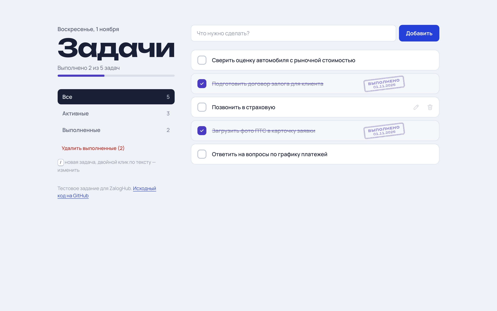

# Задачи — тестовое задание ZalogHub

Список задач на React + TypeScript (Vite).

**Демо:** https://nonncal.github.io/zaloghub-todo/

<p>
  
  
</p>

## Запуск

Нужен Node.js 20+.

```bash
git clone https://github.com/nonncal/zaloghub-todo.git
cd zaloghub-todo
npm install
npm run dev        # http://localhost:5173
```

Другие команды:

```bash
npm test           # тесты (Vitest + Testing Library)
npm run lint       # линтер (oxlint)
npm run build      # проверка типов и production-сборка в dist/
npm run preview    # просмотр собранной версии
```

## Что сделано

Требования ТЗ:

- добавление задачи через поле ввода и кнопку (или Enter);
- переключение выполнена / не выполнена;
- удаление задачи;
- фильтры «Все», «Активные», «Выполненные» со счётчиками;
- сохранение в `localStorage` — задачи остаются после перезагрузки;
- пустую строку и строку из одних пробелов добавить нельзя — поле подсвечивается, появляется подсказка;
- выполненные задачи зачёркнуты, приглушены и отмечены штампом «Выполнено» с датой.

Сверх ТЗ:

- **Отмена удаления.** После удаления появляется уведомление с кнопкой «Вернуть» (или `Ctrl/⌘ + Z`), задача возвращается на прежнее место.
- **Редактирование** двойным кликом или кнопкой с карандашом: `Enter` сохраняет, `Esc` отменяет.
- **Фильтр в адресе** (`#/active`, `#/completed`): ссылкой можно поделиться, кнопка «Назад» в браузере работает.
- **Синхронизация вкладок.** Изменения в одной вкладке сразу появляются в другой (событие `storage`).
- **Устойчивость к битым данным.** Содержимое `localStorage` проверяется type guard'ом; повреждённые записи отбрасываются, а недоступное хранилище (приватный режим Safari) не ломает приложение.
- **Адаптивная вёрстка:** телефон — одна колонка с закреплённым полем ввода, планшет — сегментированный переключатель фильтров, компьютер — две колонки с закреплённой боковой панелью.
- **Тёмная тема** по системной настройке, `prefers-reduced-motion` учитывается.
- **Доступность:** семантичные чекбоксы и кнопки, подписи для скринридеров, видимый фокус, `aria-live` для уведомлений, клавиша `/` переводит фокус в поле ввода.
- **Тесты:** 24 теста — редьюсер, разбор хранилища и пользовательские сценарии через Testing Library.
- **CI/CD:** GitHub Actions запускает линтер, тесты и сборку, затем публикует сайт на GitHub Pages.

## Устройство

```
src/
├── types.ts               модель задачи и фильтры
├── lib/
│   ├── todos.ts           чистый редьюсер и фильтрация
│   ├── storage.ts         чтение/запись localStorage с валидацией
│   └── plural.ts          склонение через Intl.PluralRules
├── hooks/
│   ├── useTodos.ts        состояние, сохранение и синхронизация вкладок
│   └── useHashFilter.ts   фильтр в URL через useSyncExternalStore
└── components/            форма, задача, фильтры, уведомление
```

Логика отделена от отображения: вся работа со списком — чистая функция `todosReducer`, которую легко тестировать без React. Дополнительных runtime-зависимостей нет, кроме шрифтов (Unbounded и Manrope через Fontsource, без запросов к сторонним CDN).

## Время

Около 2 часов: базовые требования — примерно час, остальное — дополнительные функции, тесты, адаптив и деплой.
